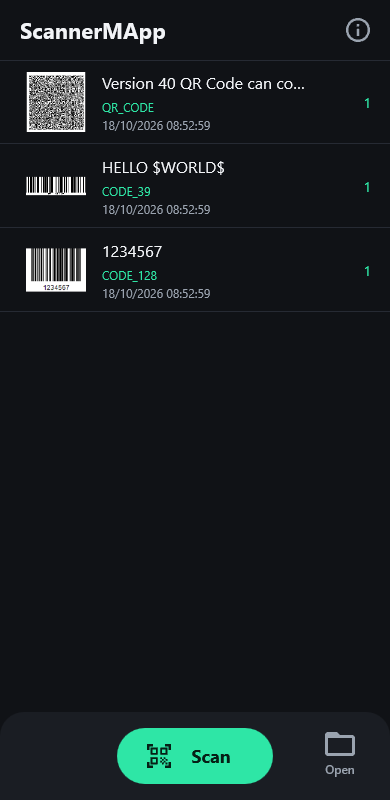
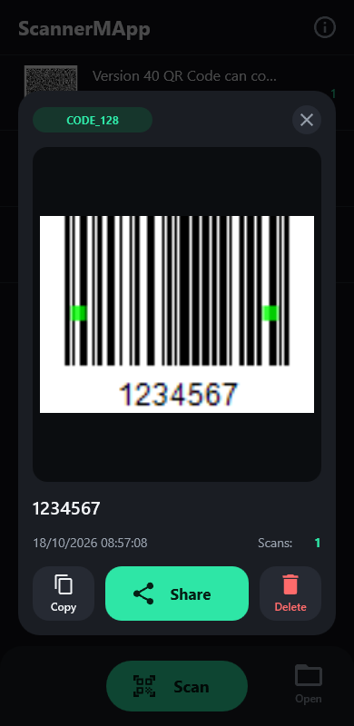
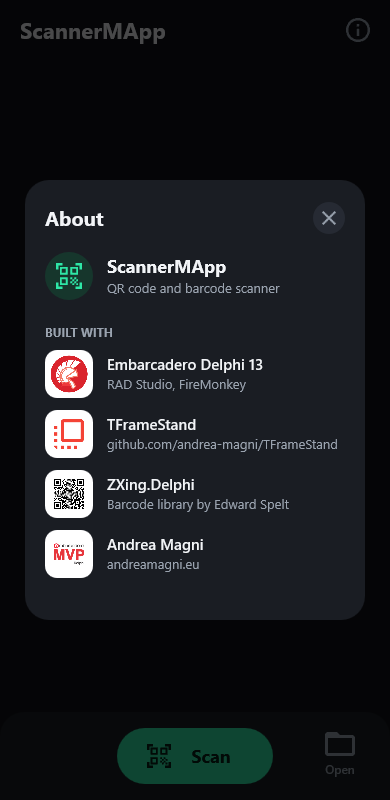

# ScannerMApp

A QR code and barcode scanner app built with Delphi and FireMonkey, using [ZXing.Delphi](https://github.com/Spelt/ZXing.Delphi) for decoding and [TFrameStand](https://github.com/andrea-magni/TFrameStand) for the views.

It started in 2017 as a sample for TFrameStand ([blog post](https://blog.andreamagni.eu/2017/06/scannermapp-a-qrbarcode-scanner-app-with-delphi-zxing-and-tframestand/)). It now builds with RAD Studio 13 and runs on recent Android versions, with a dark UI.

| Scans | Scan result | About |
|:---:|:---:|:---:|
|  |  |  |

The screenshots come from the Windows build; on Android the bottom bar has **Gallery** instead of **Open**.

## Features

- Live scanning from the camera, with a square viewfinder, the points found by ZXing and a torch button.
- Scanning from a picture in the photo library (Android) or from a file (Windows).
- Every format ZXing.Delphi supports: QR code, Data Matrix, Aztec, PDF 417, Code 39/93/128, EAN, UPC, ITF, Codabar…
- A list of the scans: the same code scanned again increments its counter.
- A result card with the scanned frame (pinch, double tap or mouse wheel to zoom, drag to pan) and **Copy**, **Share** and **Delete**.
- Android 15+ edge-to-edge: the content stays clear of the system bars.

## Requirements

- **RAD Studio 13 Florence** (Delphi 13).
- **Android 64-bit**: min SDK 24, target SDK 36. Win32 and Win64 build too (scanning from a file; the camera has not been tested on Windows).
- **[ZXing.Delphi](https://github.com/Spelt/ZXing.Delphi)**.
- **[TFrameStand](https://github.com/andrea-magni/TFrameStand)**, `master` or a release after v.2.3: it registers the interactive gestures of the frames ([#121](https://github.com/andrea-magni/TFrameStand/pull/121)). With v.2.3, pinch and double-tap zoom do nothing on Android.

## Building

The search path of the project expects the libraries next to the projects folder:

```
<root>\Librerie\TFrameStand
<root>\Librerie\ZXing.Delphi
<root>\Progetti\ScannerMApp
```

Clone them there, or change the search path in **Project ▸ Options ▸ Building ▸ Delphi Compiler ▸ Search path**.

Then open `ScannerMapp.dproj`, pick the platform and run.

For Android:
- In **Tools ▸ Options ▸ Deployment ▸ SDK Manager**, the Android SDK must have a JDK (the **Java** tab). Without it, the deployment stops because `java.exe` is not found.
- The app asks for the camera permission the first time you tap **Scan**; no storage permission is needed.

## Project structure

| Unit | Content |
|---|---|
| `Forms.Main` | Main form: header, bottom bar, permissions, safe area |
| `Data.Main` | Data module: camera, ZXing scanning, the in-memory table of the scans |
| `Frames.Scanning` | Camera preview, viewfinder, torch |
| `Frames.Data` | List of the scans |
| `Frames.ScanResult` | Result card: zoomable frame, value, Copy / Share / Delete |
| `Frames.Info` | About |
| `UI.Theme` | Palette, icons (Material Icons paths), pressed feedback |

## License

[Apache License 2.0](LICENSE).

## Related links

Embarcadero Delphi is a modern, powerful and effective language and development tool. Learn more about it at the following links:
- https://www.embarcadero.com/
- https://learndelphi.org/
