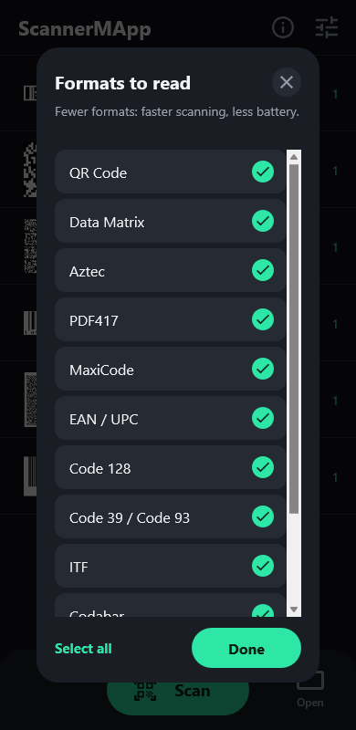

# ScannerMApp

A QR code and barcode scanner app built with Delphi and FireMonkey, using [ZXing.Delphi](https://github.com/Spelt/ZXing.Delphi) for decoding and [TFrameStand](https://github.com/andrea-magni/TFrameStand) for the views.

<a href="https://play.google.com/store/apps/details?id=eu.andreamagni.scannermapp2"></a>

It started in 2017 as a sample for TFrameStand ([blog post](https://blog.andreamagni.eu/2017/06/scannermapp-a-qrbarcode-scanner-app-with-delphi-zxing-and-tframestand/)). It now builds with RAD Studio 13 and runs on recent Android versions and on the iPhone, with a dark UI. What changed, nine years later: [ScannerMApp, nine years later: ZXing.Delphi 4, TFrameStand and Android intents](https://blog.andreamagni.eu/2026/10/scannermapp-nine-years-later-zxing-delphi-4-tframestand-and-android-intents/).

| Scans | Scan result | Formats | About |
|:---:|:---:|:---:|:---:|
|  |  |  |  |

The screenshots come from the Windows build; on Android the bottom bar has **Gallery** instead of **Open**.

## Status

| Platform | State |
|---|---|
| Android 64-bit | Tried on a phone (Android 17): camera, photo picker, shared images, **Open**. Published on **[Google Play](https://play.google.com/store/apps/details?id=eu.andreamagni.scannermapp2)** (October 2026) as `eu.andreamagni.scannermapp2`, version 2.0.0. |
| iOS (iPhone) | Tried on an iPhone: camera scanning, the camera permission, app icon and launch screen. Not on the App Store yet; **Open** for contacts and events not tried yet. |
| macOS (ARM, Intel) | Compiles and links; not tried on a Mac yet. |
| Windows (32 and 64-bit) | Scanning from a file, and "Open with"; the camera has not been tested. |

## Features

- Live scanning from the camera, with a square viewfinder, the points found by ZXing and a torch button. The frames are decoded in the background (`ScanAsync`), so the preview stays smooth. A code that is found but cannot be read yet shows a hint: hold the phone still, or move closer.
- Scanning from a picture in the photo library (Android, iOS) or from a file (Windows, macOS): every code in the image is read. On Windows an image can also be passed on the command line ("Open with").
- Every format ZXing.Delphi 4 reads automatically: QR code, Micro QR, Data Matrix, Aztec, PDF 417, MaxiCode, Code 39/93/128, EAN, UPC, ITF, Codabar, GS1 DataBar… The result card outlines the code in the frame.
- **Formats to read**: fewer formats make scanning faster and save battery. The choice is kept.
- A list of the scans, kept between runs: the same code scanned again increments its counter.
- A result card with the scanned frame (pinch, double tap or mouse wheel to zoom, drag to pan) and **Copy**, **Share** and **Delete**.
- **Open** what a code contains: a link in the browser, a phone number in the dialer, an e-mail or SMS ready to send (also `MATMSG`, `SMSTO`), a location in the maps app (`geo:`), a contact (vCard, `MECARD`) or an event (iCalendar) in the app that adds it. Only these kinds of content are offered; anything else can be copied or shared.
- Android: images **shared with** ScannerMApp (one or more, from Gallery, Photos, a chat…) or opened with it are scanned right away, also while the app is running.
- Android: only the camera permission, adaptive launcher icon (also themed), the **Back** key closes what is open and then leaves the app, edge-to-edge (Android 15+) with the content clear of the system bars.

## Requirements

- **RAD Studio 13 Florence** (Delphi 13).
- **Android 64-bit**: min SDK 24, target SDK 36. Win32 and Win64 build too (scanning from a file; the camera has not been tested on Windows).
- **iOS and macOS**: the iOS device, macOS ARM and macOS Intel targets compile and link from Windows (with the SDKs imported in RAD Studio); running them needs a Mac with PAServer. On iOS the app asks for the camera permission before it creates the camera (`Forms.Main.StartCamera`).
- **[ZXing.Delphi](https://github.com/Spelt/ZXing.Delphi) 4.0** or later, included as a git submodule in `ThirdParty\ZXing.Delphi` (branch `4.0`). Version 3.x does not build: the app uses `IScanManager` and `ScanAsync`.
- **[TFrameStand](https://github.com/andrea-magni/TFrameStand) [v.2.4](https://github.com/andrea-magni/TFrameStand/releases/tag/v.2.4)** or later, installed in the IDE (see below). It is not part of this repository: the project finds it through the IDE library path.

## Building

Clone with the submodules, so that ZXing.Delphi lands in `ThirdParty\ZXing.Delphi`:

```
git clone --recurse-submodules https://github.com/andrea-magni/ScannerMApp.git
```

In a clone made without it, run `git submodule update --init`.

TFrameStand must be installed in RAD Studio, so that its `source` folder is in the library path of every platform you build (**Tools ▸ Options ▸ Language ▸ Delphi ▸ Library**):

- with the setup of the [latest release](https://github.com/andrea-magni/TFrameStand/releases/latest), or with TMS Smart Setup (`tms install andreamagni.tframestand`);
- or from a clone of the repository (v.2.4 or later): open `packages\13Florence\FrameStand.groupproj`, install the design-time package and add the `source` folder to the library path.

The version matters: the app needs the interactive gestures of the frames registered with the hosting form ([#121](https://github.com/andrea-magni/TFrameStand/pull/121)), available since v.2.4. With v.2.3 or earlier the app builds and runs, but pinch and double-tap zoom on the scanned frame do nothing on Android.

To move ZXing.Delphi to the latest commit of its `4.0` branch: `git submodule update --remote ThirdParty/ZXing.Delphi`, then commit the new submodule commit.

Then open `ScannerMapp.dproj`, pick the platform and run.

For Android:
- In **Tools ▸ Options ▸ Deployment ▸ SDK Manager**, the Android SDK must have a JDK (the **Java** tab). Without it, the deployment stops because `java.exe` is not found.
- The app asks for the camera permission the first time you tap **Scan**; no storage permission is needed.

## Project structure

| Unit | Content |
|---|---|
| `Forms.Main` | Main form: header, bottom bar, permissions, safe area, Back key |
| `Data.Main` | Data module: camera, ZXing scanning, the table of the scans (saved in the app data folder) |
| `Data.Settings` | App data folder; the formats to read (`TScanSettings`, saved as JSON) |
| `Frames.Scanning` | Camera preview, viewfinder, torch |
| `Frames.Data` | List of the scans |
| `Frames.ScanResult` | Result card: zoomable frame, value, Copy / Share / Open / Delete |
| `Utils.ContentActions` | What a scanned value contains (link, phone, e-mail, SMS, location, contact, event) and how to open it on each platform |
| `Utils.SharedImages` | Android: images received with an intent (`SEND`, `SEND_MULTIPLE`, `VIEW`) |
| `Frames.Settings` | Formats to read |
| `Frames.Info` | About |
| `UI.Theme` | Palette, icons (Material Icons paths), pressed feedback |
| `Icons\Android` | Launcher icon: adaptive layers (vector) and legacy PNGs |
| `Icons\iOS` | App icon (every size) and launch screen image, rendered from `icon.svg` and `launch.svg` |

## Privacy

ScannerMApp collects nothing: no account, no ads, no analytics, and the Android release build has no internet permission. See the [privacy policy](PRIVACY.md).

## Google Play Store

ScannerMApp is [on Google Play](https://play.google.com/store/apps/details?id=eu.andreamagni.scannermapp2) as `eu.andreamagni.scannermapp2` (the app published until 2020 as `eu.andreamagni.ScannerMapp` was removed and cannot be updated). The **Release** configuration of **Android 64-bit** builds the App Bundle (`.aab`) for Google Play. The store listing (English and Italian), the graphics, the answers to the Play Console forms and the signing steps are in [docs/play-store](docs/play-store/README.md).

## License

[Apache License 2.0](LICENSE).

## Related links

Embarcadero Delphi is a modern, powerful and effective language and development tool. Learn more about it at the following links:
- https://www.embarcadero.com/
- https://learndelphi.org/
